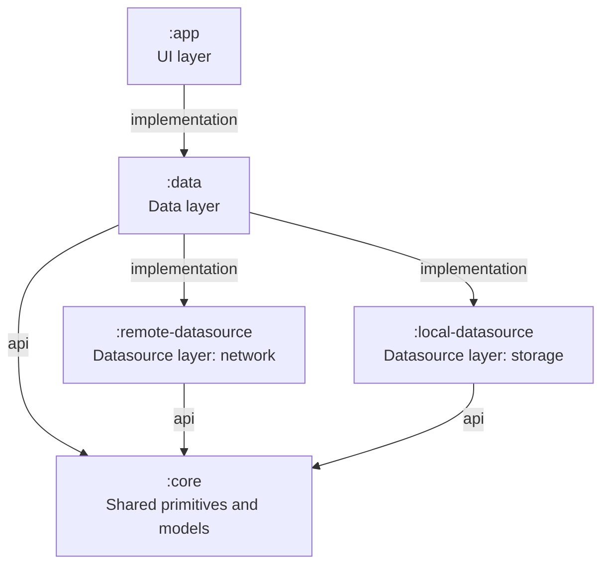

# Architecture

How CREAM is layered, how its modules depend on each other, and how objects get their dependencies.

## Layers

Data flows up: Datasource → Data → UI.

- **UI** renders state and turns user input into calls on the layer below. Composables draw; state holders (ViewModels, remembered objects) hold screen state and call into the data layer. Composables own their input types; see [ADR 0003](decisions/0003-composables-own-their-data.md).
- **Data** holds the business logic. Repositories expose operations in domain terms and decide which datasources to use, in what order, and what to do when one fails.
- **Datasource** talks to one external system, such as a backend or an on-device database, and translates between its format and domain models. It holds no business logic.

## Modules

A module can only use the modules it points to. Because `:data` depends on the datasource modules with `implementation`, `:app` can't see them; it reaches datasources only through repositories. `:core` is an `api` dependency, so the models and primitives defined there are visible to every layer. Models that a datasource returns live in `:core`.

## Dependency injection

CREAM wires dependencies by hand: no DI framework, no annotation processing, no service locator. (A hilt is the handle of a dagger. We skipped the dagger, so there's nothing to hold.)

### What a DI framework does, and how CREAM does it

| Job | How CREAM does it |
|---|---|
| Know how to build each object | Plain constructors, called by the [containers](#containers). A missing dependency is a compile error. |
| Bind an interface to its impl | Container properties are typed as interfaces; impls have `internal` constructors. See [Containers](#containers). |
| Singletons and scopes | App scope: a property on `AppContainer` or a datasource module's container, built once. Screen scope: constructed in the ViewModel's factory. See [Scope](#scope-shared-or-owned). |
| Inject ViewModels | Each ViewModel's companion `factory(appContainer)`, called with `LocalAppContainer.current`. |
| Inject Android entry points | The `Application` owns `AppContainer` and implements `AppContainerProvider`. An entry point casts `applicationContext` to `AppContainerProvider`. Today only `MainActivity` does; a future `Service`, `Worker`, or `BroadcastReceiver` does the same. |
| Runtime arguments (a nav arg, an id) | Add a parameter to the ViewModel's factory, next to `appContainer`: `factory(appContainer, accountId)`. |

### Trade-offs

Wiring by hand trades automation for visibility. Every new dependency is an edit to a container or a ViewModel factory, and that work grows with the graph. In return there's no generated code and no build-time processing, and the whole graph is ordinary Kotlin you can read top to bottom and jump through.

The containers build everything in `Application.onCreate()`. That's fine at the current size; when a dependency's construction shows up in startup time, make its property `by lazy`.

### Principles

1. **Constructor injection.** A class receives every collaborator through its constructor. It never constructs one itself or looks one up from a global. This makes each class's dependencies visible in its signature and lets tests pass in fakes.
2. **Depend on interfaces across module boundaries.** A consumer in another module sees an interface, never the impl. The module that owns the impl decides how to build it.
3. **Build the graph only in containers.** Every shared object is a property of a container, and containers are the only code that calls the constructors of injected types. Anything else that needs a shared object gets it passed in.

### Getting a dependency

If a class needs something, add it to the class's constructor. That moves the question to whoever constructs the class: they must supply it. Where they get it from depends on the dependency's scope.

### Scope: shared or owned

Ask whether two consumers holding different instances would be a bug.

- **Shared (app scope).** The dependency holds state or a resource that must be single. Examples: a database connection, a network client, an in-memory cache, a stream several screens observe. Two instances would disagree or waste the resource. Shared dependencies are built once, as a container property.
- **Owned (consumer scope).** The dependency is stateless, or its state belongs to one consumer. Examples: transformers, formatters, mappers. Whoever builds the consumer builds a fresh instance, which lives as long as the consumer. Don't make owned dependencies container properties; the container would grow into a bag of unrelated objects that everything can reach.

App-scoped objects live as long as the process. They outlive screens, navigation, and sign-out. Any user-specific state they hold must be cleared explicitly when the user changes. Work that has to outlive a screen needs an app-lifetime coroutine scope, not `viewModelScope`.

### Containers

The graph is built by a tree of containers, each built exactly once by its parent:

| Container | Module | Built by | Holds |
|---|---|---|---|
| `AppContainer` | `:data` | `CreamApplication.onCreate()` | Each datasource module's container (private) and the repositories (public, interface-typed). |
| `RemoteDataSources` | `:remote-datasource` | `AppContainer`, via `remoteDataSources()` | Remote datasources, and the network clients they share (private). |
| `LocalDataSources` | `:local-datasource` | `AppContainer`, via `localDataSources(context)` | Local datasources, and the database they share (private). |
| ViewModel factory | `:app` | The composable that shows the screen, via `viewModel(factory = …)` | One ViewModel, plus the owned dependencies it constructs, such as its UI transformer. |

A datasource module exposes exactly one public entry point: its container interface and the factory function that builds it. Datasource impls have `internal` constructors and are built only inside the module's container impl. `:data` can't build a datasource any other way, so it can't build two by accident.

Repositories are built directly in `AppContainer`. They live in `:data` alongside it, so nothing crosses a module boundary and no factory is needed. Nothing outside `:data` constructs a repository impl.

ViewModels need a factory for a different reason: Android constructs them, so a `ViewModelProvider.Factory` is the only way to pass constructor arguments. The template is in the [`cream-viewmodel` skill](../.claude/skills/cream-viewmodel/SKILL.md).

The UI reaches `AppContainer` through composition. `MainActivity` reads it from the `Application` and provides it through `LocalAppContainer`, once, at the root of the tree. Composables read `LocalAppContainer.current` and pass it to a ViewModel factory. Nothing else touches the `Application`, and no composable takes the container or a repository as a parameter.

### Sharing one instance

A constructor or factory function builds a new object every time it's called. A shared dependency is built once and handed to each consumer; it's never shared by calling its factory again.

- **Several consumers in one container,** such as two repositories that need the same datasource, or two datasources that need the same network client: hold the dependency in one container property and pass it to each constructor.
- **A process-wide platform resource** with one-time setup, such as a Firebase client pointed at an emulator or a database file: hold it at file level in the container impl's file, as a `private val … by lazy`, or behind a synchronized `getInstance` when it needs arguments. Then building a container twice, by mistake or in a test, still can't set it up twice. Platform `getInstance()` calls appear only there.

### Finding a dependency

The code is the graph. To find where a dependency comes from, follow constructors up: the class's constructor, then the container that calls it. Containers are the only places objects are built, so the trail always ends in one of the files above. To see everything shared at app scope, read `AppContainer` and the two datasource module containers it builds. Together they're the whole app-scope graph.

### Testing

Constructor injection is the test seam. A test constructs the class under test directly and passes MockK mocks for its collaborators. An impl's tests live in the impl's module, so its `internal constructor` is visible to them. No test builds a container.

Not covered yet: tests that run the real app with fakes behind it, such as instrumented UI tests. They need every consumer to get a fake from `AppContainer`, but `AppContainer` builds its datasource containers itself. Supporting them means letting `AppContainer` take its datasource containers as constructor parameters, so a test `Application` can pass fakes. Decide that when the first such test is written.

### Adding a dependency

1. **Check the containers first.** If what you need is already a container property, use it. Don't build a second one.
2. Add it to the constructor of the class that uses it.
3. Decide its scope.
4. **Shared datasource:** add a property to the module's container interface, and build the impl in the container impl. A client it shares with other datasources goes in a private property of the container impl, or at file level if it's process-wide (see [Sharing one instance](#sharing-one-instance)).
5. **Shared repository:** add an interface-typed property to `AppContainer`, passing it datasources from the module containers.
6. **Owned:** construct it where its consumer is constructed, such as the ViewModel's companion factory.
7. **New datasource module:** give it a container interface, an `internal` container impl, and a factory function, and build it once as a private property of `AppContainer`.
